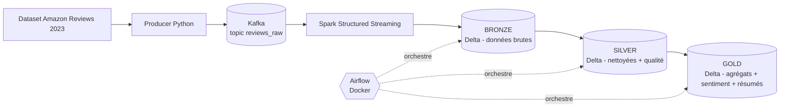

#  Amazon Reviews Lakehouse

Pipeline Big Data de bout en bout sur des **avis produits Amazon** : ingestion en streaming avec **Kafka**, traitement avec **PySpark**, stockage en architecture **Lakehouse (Delta Lake)**, orchestration avec **Airflow + Docker**, puis **analyse de sentiment** et **résumé automatique** des avis avec **Hugging Face** et **LangChain**.
 Projet en cours de construction. L'avancement de chaque étape est indiqué dans la [feuille de route](#-feuille-de-route).

---

##  Objectifs

- Concevoir une architecture **Lakehouse (Bronze / Silver / Gold)** avec Kafka, PySpark et Delta Lake
- Orchestrer les pipelines ETL avec **Airflow** et **Docker**, avec un **contrôle qualité** des données
- Développer un module d'**analyse de sentiment** et de **résumé automatique** des avis (Hugging Face + LangChain)

---

##  Architecture



| Couche | Rôle |
|---|---|
| **Bronze** | Données brutes issues de Kafka, stockées telles quelles en Delta |
| **Silver** | Données nettoyées, dédupliquées, avec contrôle qualité |
| **Gold** | Agrégats par produit, score de sentiment, résumés automatiques |

---

##  Stack technique

| Domaine | Outils |
|---|---|
| Streaming | Apache Kafka (mode KRaft, sans Zookeeper), Kafka UI |
| Traitement | PySpark, Spark Structured Streaming |
| Stockage | Delta Lake |
| Orchestration | Apache Airflow, Docker, Docker Compose |
| Qualité des données | Great Expectations ou contrôles PySpark |
| NLP | Hugging Face Transformers, LangChain |
| Langage | Python 3.12 |

---

##  Dataset

**Amazon Reviews 2023** (McAuley Lab, UCSD), catégorie **All_Beauty**.

- Page du dataset : https://huggingface.co/datasets/McAuley-Lab/Amazon-Reviews-2023
- Site du projet : https://amazon-reviews-2023.github.io
- Format : **JSONL** (un avis JSON par ligne)
- Échantillon utilisé : les **50 000 premiers avis** du fichier (ordre du fichier, pas un tirage aléatoire)

Champs principaux : `rating`, `title`, `text`, `asin`, `parent_asin`, `user_id`, `timestamp`, `helpful_vote`, `verified_purchase`.

> Le dataset n'est **pas** versionné dans ce dépôt (`data/` est dans le `.gitignore`). Consulte la page du dataset pour sa licence et ses conditions d'usage.

---

##  Structure du projet

```
amazon-lakehouse/
├── docker-compose.yml        # Kafka (KRaft) + Kafka UI
├── data/                     # dataset local (ignoré par Git)
├── producer/
│   ├── download_sample.py    # télécharge un échantillon de 50 000 avis
│   └── producer.py           # envoie les avis dans Kafka
├── spark_jobs/               # bronze.py, silver.py, gold.py (à venir)
├── nlp/                      # sentiment.py, summarizer.py (à venir)
├── airflow/dags/             # DAGs d'orchestration (à venir)
├── tests/
└── README.md
```

---

##  Prérequis

- **Docker Desktop** (6 Go de RAM minimum alloués, 8 Go conseillés) : https://www.docker.com/products/docker-desktop
- **Git** : https://git-scm.com
- **Python 3.12** (évite la 3.14, trop récente pour PySpark et les bibliothèques NLP)
- **VS Code** (recommandé) : https://code.visualstudio.com

Vérification :

```powershell
docker --version
docker compose version
git --version
py -0          # doit lister la version 3.12
```

---

##  Installation et exécution, étape par étape

> Les commandes ci-dessous sont écrites pour **Windows PowerShell**. Sur Linux/macOS, remplace l'activation du venv par `source .venv/bin/activate`.

### Étape 1 : Initialiser le projet, Kafka et Kafka UI

**1.1 Cloner le dépôt** (ou créer le projet en local)

```powershell
git clone https://github.com/Sirine-Hakim/amazon-lakehouse.git
cd amazon-lakehouse
```

**1.2 Créer l'environnement virtuel Python 3.12**

```powershell
py -3.12 -m venv .venv
.venv\Scripts\Activate.ps1
python --version
```

Le prompt doit afficher `(.venv)` et Python doit être en `3.12.x`.
Si PowerShell bloque l'activation : `Set-ExecutionPolicy -Scope CurrentUser RemoteSigned`.

**1.3 Démarrer Kafka et Kafka UI** (Docker Desktop doit être lancé)

```powershell
docker compose up -d
docker ps
```

Deux conteneurs doivent être `Up` : `kafka` (port 9092) et `kafka-ui` (port 8080).

**1.4 Créer le topic Kafka** (commande sur une seule ligne)

```powershell
docker exec kafka /opt/kafka/bin/kafka-topics.sh --create --topic reviews_raw --partitions 3 --replication-factor 1 --bootstrap-server localhost:9092
```

**1.5 Vérifier**

Ouvre **http://localhost:8080** > *Topics* : le topic `reviews_raw` doit apparaître avec 3 partitions.

>  Pourquoi 3 partitions ? Elles permettent à Spark de lire le flux en parallèle. La clé des messages étant l'identifiant du produit, tous les avis d'un même produit arrivent dans la même partition.

---

### Étape 2 : Ingestion, du dataset vers Kafka

**2.1 Installer les dépendances**

```powershell
pip install kafka-python-ng huggingface_hub
```

**2.2 Télécharger l'échantillon de 50 000 avis**

```powershell
python producer/download_sample.py
```

Le script télécharge le fichier `All_Beauty.jsonl` (environ 327 Mo, mis en cache par Hugging Face) et en extrait les 50 000 premières lignes dans `data/reviews_sample.jsonl`.

Vérification :

```powershell
dir data
(Get-Content data\reviews_sample.jsonl | Measure-Object -Line).Lines   # attendu : 50000
```

> Les avertissements Hugging Face sur les *requêtes non authentifiées* et les *symlinks* sous Windows sont sans conséquence.

**2.3 Envoyer les avis dans Kafka**

```powershell
python producer/producer.py
```

Le producer lit le fichier ligne par ligne et publie chaque avis en JSON dans le topic `reviews_raw`, avec `parent_asin` comme clé.

**2.4 Vérifier**

- **Kafka UI** : *Topics* > `reviews_raw` > le *Message Count* doit approcher **50 000**
- **Ligne de commande** :

```powershell
docker exec kafka /opt/kafka/bin/kafka-get-offsets.sh --bootstrap-server localhost:9092 --topic reviews_raw
```

(la somme des 3 partitions doit faire 50 000)

---

### Étape 3 : Couche Bronze (Spark Structured Streaming → Delta Lake) 🔜

Lecture du topic `reviews_raw` avec Spark Structured Streaming et écriture **brute** au format Delta dans la couche Bronze, avec checkpoints pour garantir la reprise sans doublon.

```powershell
# à venir
python spark_jobs/bronze.py
```

### Étape 4 : Couche Silver (nettoyage et contrôle qualité) 🔜

Typage des colonnes, suppression des doublons et des avis vides, conversion des timestamps, contrôles qualité (taux de valeurs nulles, notes entre 1 et 5, unicité). Les lignes rejetées sont comptées et conservées à part.

```powershell
# à venir
python spark_jobs/silver.py
```

### Étape 5 : Orchestration avec Airflow et Docker 🔜

DAG Airflow qui enchaîne Bronze → Silver → Gold. Le pipeline **échoue** si le contrôle qualité n'atteint pas le seuil défini.

```powershell
# à venir
docker compose -f docker-compose.airflow.yml up -d
```

### Étape 6 : Analyse de sentiment (Hugging Face) 🔜

Score de sentiment par avis avec un modèle de la bibliothèque Transformers, comparé à la note en étoiles.

### Étape 7 : Résumé automatique par produit (LangChain + Hugging Face) 🔜

Résumé des avis de chaque produit avec une approche *map-reduce* : résumés partiels, puis résumé final.

### Étape 8 : Couche Gold et visualisation 🔜

Agrégats par produit (note moyenne, part d'avis positifs, résumé) stockés en Delta, avec un tableau de bord optionnel (Streamlit).

---

##  Feuille de route

- [x] **Étape 1** : Setup du projet, Kafka (KRaft) et Kafka UI
- [ ] **Étape 2** : Producer Python → Kafka
- [ ] **Étape 3** : Bronze (Spark Streaming → Delta Lake)
- [ ] **Étape 4** : Silver (nettoyage + contrôle qualité)
- [ ] **Étape 5** : Orchestration Airflow + Docker
- [ ] **Étape 6** : Analyse de sentiment (Hugging Face)
- [ ] **Étape 7** : Résumé automatique (LangChain)
- [ ] **Étape 8** : Gold + dashboard

---

##  Résultats

> À compléter au fil du projet avec les chiffres réels mesurés.

| Indicateur | Valeur |
|---|---|
| Avis ingérés dans Kafka | _à renseigner_ |
| Temps d'ingestion | _à renseigner_ |
| Lignes rejetées par le contrôle qualité (Silver) | _à renseigner_ |
| Durée totale du pipeline | _à renseigner_ |
| Précision du sentiment vs notes en étoiles | _à renseigner_ |

---

##  Dépannage

| Problème | Solution |
|---|---|
| `python` introuvable | Installer Python 3.12 en cochant « Add python.exe to PATH », puis rouvrir le terminal |
| Le venv ne s'active pas | `Set-ExecutionPolicy -Scope CurrentUser RemoteSigned` |
| `docker ps` vide | Lancer Docker Desktop, puis `docker compose up -d` |
| `NoBrokersAvailable` | Attendre 20 secondes après le démarrage de Kafka, vérifier `docker ps` |
| `ModuleNotFoundError: kafka` | Activer le venv puis `pip install kafka-python-ng` |
| Port 8080 ou 9092 déjà utilisé | Changer le port de gauche dans `docker-compose.yml` (ex. `"8081:8080"`) |
| Pousser sur GitHub échoue (`main` introuvable) | `git branch -M main` puis `git push -u origin main` |

---

##  Références

- Dataset : Amazon Reviews 2023, McAuley Lab (UCSD). Voir la section *Citation* de la [page du dataset](https://huggingface.co/datasets/McAuley-Lab/Amazon-Reviews-2023) pour la référence de l'article.

---

##  Auteure

**Sirine Hakim**
GitHub : [@Sirine-Hakim](https://github.com/Sirine-Hakim)